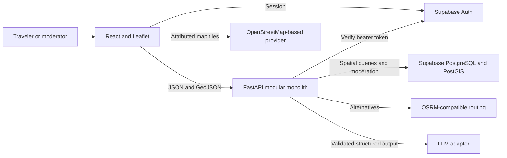
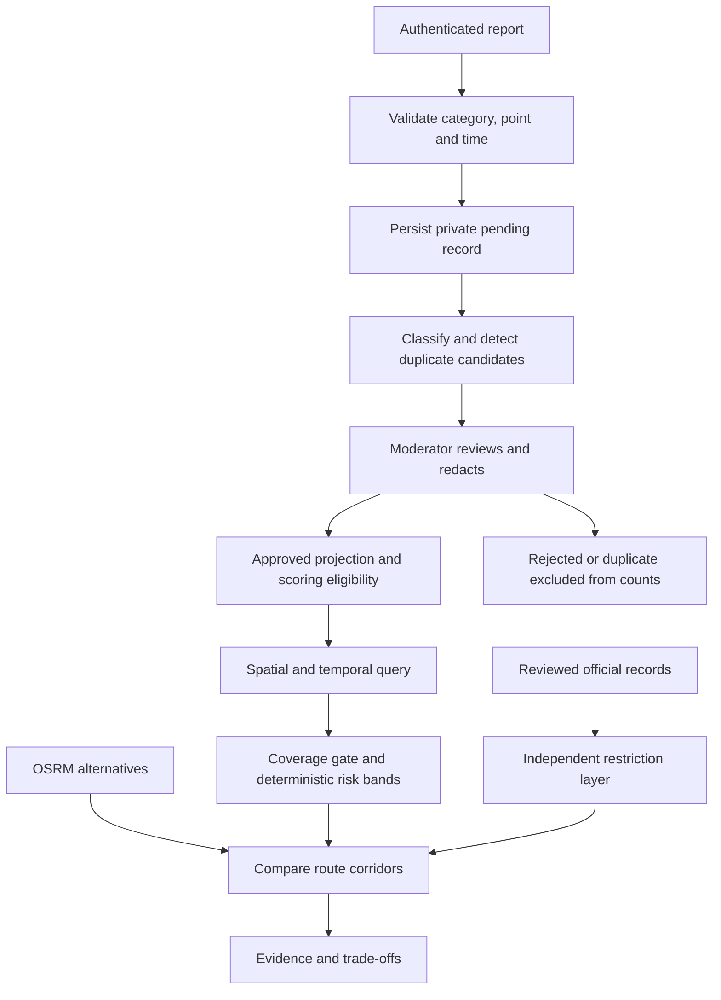

# Architecture

FastAPI validates inputs and authentication, owns the public data projection, and orchestrates scoring, routing, and model calls. PostGIS stores indexed geography and provenance. The browser renders layers and explanations. Phase 1 adds registered-user submission, reviewed public incident reads, and GeoJSON zones. FastAPI verifies bearer tokens with Supabase Auth, writes reports in a database transaction, and uses PostGIS for public spatial queries. Phase 2 renders separate Leaflet tile, incident, and advisory layers. Viewport changes are debounced and superseded requests are cancelled. The browser holds a Supabase access token in memory for authenticated incident creation. Draft coordinates stay in the report view until submission, and the public layers use only the API's rounded locations.

Reports may contribute a labeled unverified marker after redaction review. Only corroborated or verified evidence contributes to live scoring. AI failures leave the private report available for manual review. The heatmap recomputes from eligible rows on each request. Viewport changes, period changes, and explicit refresh trigger a request.

## Map-first frontend

React Leaflet manages viewport movement, map gestures, marker clustering, report placement, and authoritative advisory polygons. `MapWorkspace` owns viewport data and a single contextual panel. Search matches curated Multan landmarks, coordinates, and public reports in the current view locally. The map uses locally served Inter, neutral surfaces, and compact floating controls. The same panel becomes a bottom sheet above mobile navigation.

The heatmap renderer converts grid IDs to projected sample centers. A compact radial kernel blends scores with normalized weights inside sufficiently sampled cells. A coverage mask keeps sparse or missing cells clear and prevents green from bleeding into higher-risk cells. The default display bands are 0–20, 21–40, 41–60, 61–80, and 81–100, with a smooth transition from green through yellow-green, yellow, orange, and red. Display breakpoints and kernel radius are configurable. Activity uses a separate blue-to-purple ramp and sums weighted report counts to show concentration. The exact cell evidence remains available on selection. Official advisories sit on their own pane above both surfaces.

React Leaflet preserves the established map gestures, map pins, advisory polygons, and attribution. The raster renderer shares a color ramp between WebGL and Canvas2D. Leaflet anchors the rendered image to its geographic bounds, scales it during gestures, and swaps in the new surface after decoding. Radius and opacity vary with zoom. The client reuses rendered surfaces for the same cells, layer, view, and zoom bucket.

Viewport requests remain debounced. The heatmap caches six query results for 30 seconds and retains the previous surface while panning or refreshing within the same date, period, and mode. Changes to those filters discard the old surface. Explicit refresh bypasses the cache. The planner opens a side panel on desktop and a bottom sheet on mobile.

The interface draws on direct map interaction and compact filters, familiar search and place details, and visually blended map layers. [Karachiwala map](https://www.karachiwala.pk/map) · [Apple Maps search](https://support.apple.com/en-euro/guide/maps/mps724f1a39a/mac) · [Google Maps controls](https://support.google.com/maps/answer/144339) · [Mapbox heatmap example](https://docs.mapbox.com/mapbox-gl-js/example/heatmap-layer/)

## Phase 3 heatmap scoring

PostGIS selects up to 500 origin-aligned Web Mercator squares. It uses the full selected cells and the existing spatial index on rounded public points, then aggregates in one query by cell and category. This keeps scores stable when panning inside the same cell at the same resolution. Grid size is in projected metres, so ground width varies by latitude. WGS84 polygons are returned for display. [PostGIS square grid](https://postgis.net/docs/ST_SquareGrid.html)

Each public corroborated or verified report contributes to its own cell. Each dimension sums contributions independently. Road accidents, unsafe roads, poor lighting, landslides, and road closures belong to road hazards. Other categories belong to community safety. Advisories stay separate and above the heatmap.

The contribution multiplies the following factors.

- Severity from 1 to 5. Legacy null values use 1.
- Corroboration weight of 0.75 for corroborated and 1.0 for verified. Private credibility metadata stays outside the calculation.
- Recency weight of `2^(-age_days / 14)`, anchored at the earlier of the window end and generation time.
- Spatial weight of `max(0.25, 1 - 0.75 × center_distance / half_diagonal)`, measured using the rounded public point in the projected grid.
- Category weight of 1.25 for robbery, 1.2 for road accidents, 0.7 for suspicious activity, 0.8 for other, and 1.0 otherwise.

Round contributions to six decimals before summing. Multiply the total by 20, round half up, and cap at 100. The default thresholds are green below 25, yellow from 25 to 59, and red from 60. Apply those bands only after at least two eligible reports in the cell and dimension. One report means limited coverage. Zero means unavailable coverage. Both return grey and a null score.

The date range bounds source records. Recurring local hours filter within that range, with night matching both sides of midnight. Heatmap v1 uses stored moderation decisions. Moderators resolve duplicate candidates before publication. Its count threshold measures sample sufficiency under a prototype rule. Real reporting coverage and predictive validity require separate validation.

## Phase 4 incident intelligence

The report confirmation starts a separate authenticated analysis request after the report is committed. API clients can start it explicitly. A database lease deduplicates concurrent requests. The service commits the claim before calling the configured provider and uses a run UUID to prevent a stale worker from overwriting a newer attempt. The original incident is never updated by analysis.

The classifier adapter targets Chat Completions with JSON mode. Pydantic checks the taxonomy, severity, confidence, and field limits. Mentioned locations, times, and entities must match literal text spans. The prompt supports English, Urdu, Roman Urdu, and mixed reports and keeps the submitted location and timestamp authoritative. The service retries transient provider errors once and logs duration, model, retry count, and token totals when supplied. [Chat Completions JSON mode](https://developers.openai.com/api/docs/guides/structured-outputs)

PostGIS selects up to 50 candidate reports within 350 metres and 90 minutes in the same demo/live mode. Lexical overlap contributes 45%, shared entities 10%, category match 15%, distance 15%, and time 15%. Candidates require at least 20% lexical overlap and a combined score of 0.62, and moderators see at most five. A shared report or distinct account does not establish independent corroboration.

The assessment records evidence presence, missing evidence, category disagreement, and large discrepancies in explicit 24-hour clock mentions. No link content is retrieved. Moderation remains an authorized database workflow. Reviewed severity affects heatmap scoring only when a moderator writes it to the original incident and the existing public eligibility conditions are met.

## Phase 5 journey comparison

The server requests up to three driving alternatives from an OSRM-compatible provider and validates the returned distance, duration, endpoints, and geometry. Trip references expire after 15 minutes and are scoped to one provider response. Travel time is a provider estimate. The configured departure time determines the evidence and advisory windows. [OSRM API](https://project-osrm.org/docs/v5.24.0/api/)

PostGIS matches corroborated and verified public report locations within 250 m of each route over the 30 days ending at the earlier of departure or comparison time. The route calculation reuses the heatmap severity, corroboration, recency, category, and sample rules. Its distance factor is `max(0.25, 1 − 0.75 × distance_m / 250)`. It divides weighted totals by `max(1, route_km)` before applying the 0–100 scale independently to community safety and road hazards. Results use the prototype sample gate. Routes sharing a corridor can match the same reports. [PostGIS ST_DWithin](https://postgis.net/docs/ST_DWithin.html)

A separate query finds stored zones that intersect the route and apply at some point between departure and estimated arrival. The check is conservative and does not predict the time at which a particular segment is reached. Balanced ordering places routes without a stored closure or restriction first, then sorts by ETA. Advisory matches remain visible in all orderings. Coverage remains incomplete, including when there are no stored matches. Demo comparison uses fictional reports and advisories with real street geometry.

## Phase 6 travel assistant

The backend interprets each turn as one validated intent. Gemini or a configured Chat Completions model selects the intent, place mentions, and time and category filters in JSON. The server verifies that model-supplied names occur in the question. Guided interpretation runs when the model is disabled or fails. Unauthenticated demo defaults to guided interpretation. A server setting enables Gemini for private demos. There is one model round and up to six controlled calls, with bounded provider and database timeouts. The model receives no database or incident tool results. The server renders facts, citations, missing sources, and map actions directly from validated tool output.

Area evidence uses a geographical radius with the heatmap's eligibility, weighting, period rules, and coverage gate. Heatmap explanation instead uses the exact selected grid cell and its date filters. Nearby incident search uses the rounded public location and only corroborated and verified reports. Advisory lookup uses stored geometry and effective dates. Route questions reuse the OSRM and PostGIS route services. Follow-ups can rerun a trip for a changed departure or compare its unexpired references.

An in-process store keeps the most recent resolved area and journey, an optional clarification, and an idle expiry of 15 minutes. It binds random conversation IDs to account and mode, or to the demo request client. It stores no chat transcript. Horizontal scaling requires shared session and rate-limit storage. The browser retains its last eight turns in memory and can clear the server context. A Pakistan-first place adapter uses a small public gazetteer, then optionally searches a configured Nominatim-compatible endpoint and asks the user to choose between materially different matches. [Nominatim search API](https://nominatim.org/release-docs/latest/api/Search/)

The bundled gazetteer uses existing Multan landmarks and public locality references. Hunza resolves to a choice of towns. [GeoNames](https://www.geonames.org/advanced-search.html?country=PK) · [Naran OpenStreetMap node](https://www.openstreetmap.org/node/274088469) · [Getty Karimabad record](https://www.getty.edu/vow/TGNFullDisplay?subjectid=1083365) · [Aliabad OpenStreetMap node](https://www.openstreetmap.org/node/734223824)

## Phase 7 operational checks

`/api/health` checks the API process. `/api/ready` verifies PostGIS and the required relations. Run the separate SQL check after schema changes to verify spatial indexes and restricted database grants. The reporting API owns all submissions and enforces its per-account rate limit in the transaction. Hosted builds use explicit HTTPS origins and public Supabase credentials. [Deployment steps](DEPLOYMENT.md)
